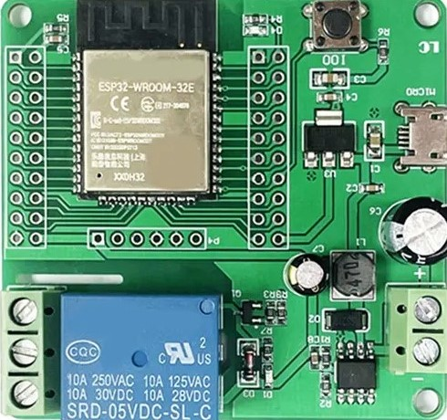
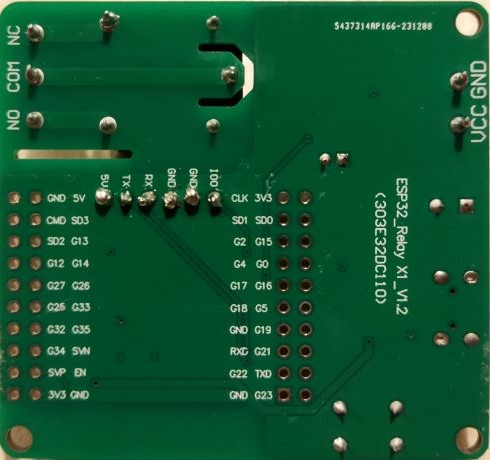
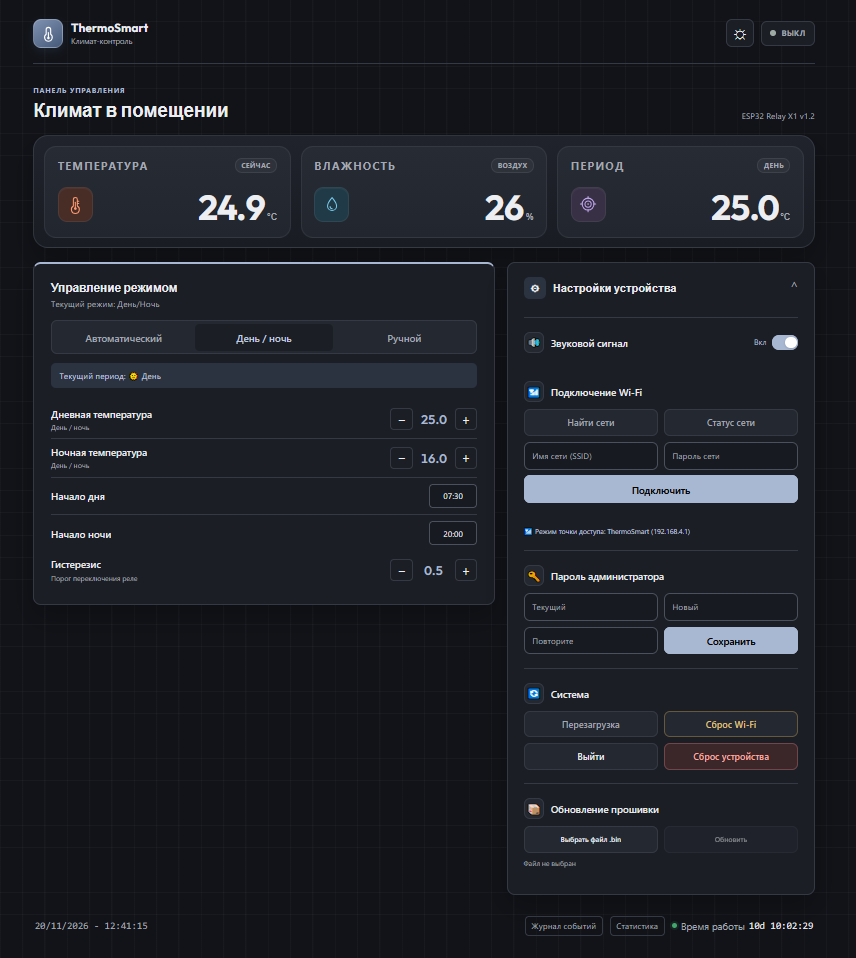
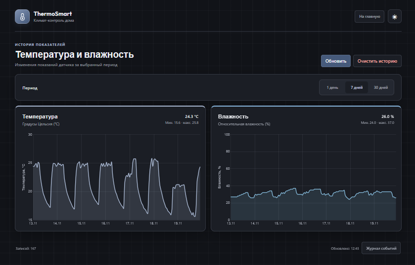
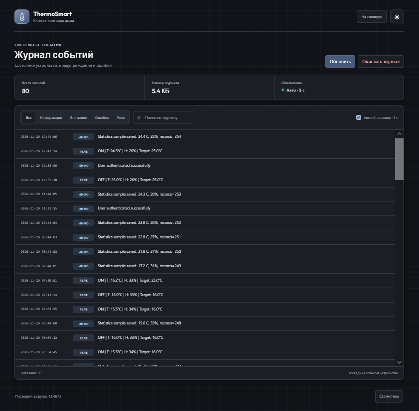

# ThermoSmart

Умный термостат на **ESP32 Relay X1 v1.2** + датчик **SHTC3**. Управляет реле нагревателя, поддерживает температуру в трёх режимах, ведёт журнал и статистику, обновляется по OTA.

## Внешний вид и интерфейс

| Плата сверху | Плата снизу |
| :---: | :---: |
|  |  |

| Панель управления | История показателей | Журнал событий |
| :---: | :---: | :---: |
|  |  |  |

## Возможности

- Режимы: **Авто** (постоянная цель), **День/Ночь** (по расписанию, время по NTP), **Ручной**
- Гистерезис `0.1–2.0 °C`
- Отказ датчика → реле безопасно выключается + звуковая сигнализация (в ручном режиме реле не трогает)
- Статистика раз в час, до 720 записей (~30 дней), графики (Chart.js)
- Журнал событий в SPIFFS (ротация в `.bak` при достижении 20 КБ)
- Авторизация по паролю, веб-интерфейс со светлой и тёмной темой
- OTA-обновление через веб-интерфейс, AP-режим с captive-порталом при потере Wi-Fi
- Настройки в NVS (`Preferences`) — переживают перезагрузку и обновление прошивки

## Подключение

| Функция | GPIO | Примечание |
|---|:---:|---|
| Реле | `16` | Управление нагрузкой |
| Светодиод | `23` | Индикатор состояния реле |
| Зуммер | `22` | Звуковая индикация и тревога |
| Кнопка BOOT | `0` | Удержание 5 с — заводской сброс |
| SHTC3 SDA / SCL | `4` / `5` | Шина I2C, адрес `0x70` |

> **Важно:** питание датчика SHTC3 — строго **3.3 В**.

Калибровка (SHTC3 обычно завышает температуру из-за самонагрева платы) — в `config.h`:

```cpp
#define TEMP_CALIBRATION   -3.0
```

## Прошивка

- Плата в Arduino IDE: **ESP32 Dev Module** (ядро `esp32` от Espressif)
- Библиотека: **ArduinoJson** (v6.x)
- Схема разметки (Partition Scheme): **`Default 4MB with spiffs (1.2MB APP/1.5MB SPIFFS)`** — обязательна для работы OTA, журнала и статистики.

Все `.ino` и `.h` файлы должны находиться в одной папке `ThermoSmart_Relay_X1_v1.2`.

## Первый запуск

Если учётные данные Wi-Fi не заданы или сеть недоступна, устройство поднимает точку доступа:
- **SSID:** `ThermoSmart` | **Пароль:** `18101990` | **IP:** `http://192.168.4.1`
- Вход в панель: пароль по умолчанию **`admin`** (сменить в разделе *«Настройки устройства»*)
- Там же в блоке *«Подключение Wi-Fi»* выберите домашнюю сеть, введите пароль и нажмите *«Подключить»*.

## Логика термостата

```text
T <= Цель − Гистерезис  →  реле ВКЛ
T >= Цель               →  реле ВЫКЛ
```

Пример: цель `22.0 °C`, гистерезис `0.5 °C` → включение при `21.5 °C`, выключение при `22.0 °C`.

## API

Все запросы (кроме `POST /auth`) требуют заголовок `Authorization: Bearer <пароль>`.

| Метод | Путь | Назначение |
|---|---|---|
| `GET` | `/api/state` | Текущие показания, статус реле и все настройки |
| `POST` | `/api/set` | Изменение настроек (`mode`, `autoTarget`, `dayTemp`, `nightTemp`, `dayStart`, `nightStart`, `hysteresis`, `manualRelay`) |
| `GET`/`POST` | `/api/buzzer` | Состояние звука / вкл-выкл (`{"enabled":true}`) |
| `GET` | `/api/wifi/status`, `/api/wifi/scan` | Статус подключения и сканирование сетей |
| `POST` | `/api/wifi/connect` | Подключение к сети (`{"ssid":"...","password":"..."}`) |
| `GET` | `/api/stats?days=N` | Статистика за `N` дней (`1–30`) |
| `POST` | `/api/clear-stats` | Очистить историю показаний |
| `GET` | `/api/logs`, `/api/logs/info` | Текст журнала и его размер |
| `POST` | `/api/logs/clear` | Очистить журнал |
| `POST` | `/change-password` | Смена пароля (`{"old":"...","new":"..."}`) |
| `POST` | `/update` | OTA-обновление (загрузка `.bin`) |
| `GET` | `/restart`, `/factory-reset` | Перезагрузка / полный сброс |
| `POST` | `/reset-wifi` | Сброс только настроек Wi-Fi |

Пример управления через `curl`:

```bash
curl -X POST -H "Authorization: Bearer admin" -H "Content-Type: application/json" \
     -d '{"autoTarget":23.5}' http://192.168.1.50/api/set
```

## OTA-обновление

В Arduino IDE выберите **Sketch → Export compiled Binary** (появится файл `ThermoSmart_Relay_X1_v1.2.ino.bin`). Загрузите его через веб-интерфейс в разделе *«Настройки устройства → Обновление прошивки»*.

## Сброс

- **Wi-Fi** — кнопка *«Сброс Wi-Fi»* в веб-интерфейсе (пароль администратора и настройки термостата сохраняются).
- **Заводской** — удержание кнопки `BOOT` 5 секунд или кнопка *«Сброс устройства»* в интерфейсе (пароль сбрасывается на `admin`, настройки — на значения по умолчанию, журнал очищается).

## Безопасность

Веб-сервер работает по HTTP без шифрования — используйте устройство только в доверенной локальной сети. Перед установкой на объект обязательно смените пароль `admin` в интерфейсе и `AP_PASSWORD` в `config.h`.

## Структура проекта

```text
ThermoSmart_Relay_X1_v1.2.ino  — основной скетч, логика термостата и работа с SHTC3
config.h                       — распиновка, константы и калибровка датчика
buzzer.h                       — неблокирующий драйвер зуммера
logger.h                       — кольцевой журнал событий в SPIFFS
stats.h                        — почасовой сбор и хранение статистики в JSON
web.h                          — веб-сервер, REST API, авторизация и OTA
web_*_page.h                   — HTML/CSS/JS шаблоны страниц в PROGMEM
docs/                          — фотографии платы и скриншоты интерфейса
```
